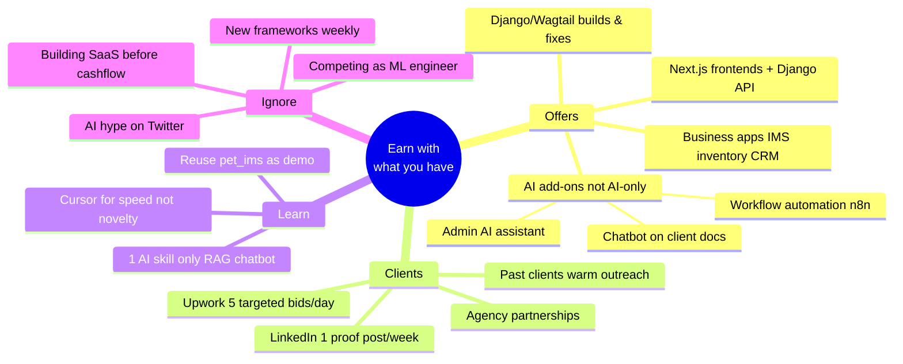
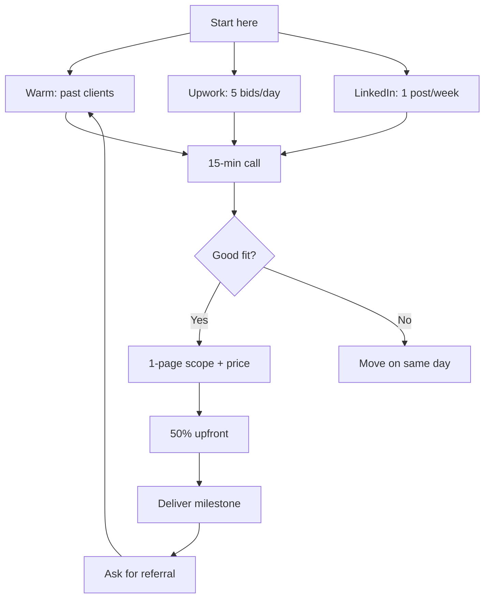

# Freelancer Focus Plan — Imtiaz Ahmed

> **Created:** 2026-06-17  
> **Situation:** Full-stack freelancer (Django + React/Next.js), struggling to get clients, overwhelmed by AI noise  
> **Goal:** Stay focused, earn within 30–60 days, learn AI *as leverage* — not as a new career

**Read this note once. Execute the [[#Your only 3 offers (pick these, ignore everything else)]] section. Everything else is reference.**

---

## The one sentence that fixes the overwhelm

> **You are not an "AI freelancer." You are a full-stack developer who ships business web apps — and uses AI to deliver faster than competitors.**

Clients still pay for: working software, reliable delivery, someone who understands their business logic. AI didn't kill that. It killed *slow, generic* freelancers who compete on price alone.

Your edge: **7.8 GB of client project history**, production Django/Wagtail apps, Docker deployment skills, and AI tools (Cursor, Ollama) that let you quote tighter timelines.

---

## Mind map — your path forward



---

## What you actually have (from your system)

| Asset | Why it matters for money |
|---|---|
| **Django / Wagtail** (pet_ims, sales-and-inventory, 1.7 GB Wagtail folder) | Businesses pay $3k–$15k for CMS + admin systems |
| **React / Next.js / Vite** (next-learn, create-next-app) | Modern frontends clients expect |
| **Docker + nginx + PostgreSQL + Redis** | "It works on my machine" → production deploy = premium skill |
| **fly.io config** (test-ai project) | Can offer deploy + hosting setup |
| **Client project archive** (client-proejcts, 7.8 GB) | Past clients = fastest leads |
| **Upwork installed** | Channel already set up — use it narrowly |
| **Cursor + Ollama + n8n** | Build AI features in days, not weeks |
| **SSH keys for GitHub/GitLab** | Ready to ship on client repos immediately |

**Your stack in one line for profiles:**
> Full-stack developer — Django, Wagtail, React/Next.js, PostgreSQL, Docker. I build and fix business web applications.

---

## Your only 3 offers (pick these, ignore everything else)

Do not list 10 services. List 3. Everything you pitch fits one of these.

### Offer 1 — Django / Wagtail fix & build *(core income)*

**Who buys:** Small businesses, agencies, startups with an existing Python site or needing a CMS.

**What you sell:**
- Bug fixes and feature additions on Django/Wagtail sites
- New admin modules (inventory, orders, reports)
- Python/Django version upgrades
- API integrations (payments, shipping, CRM)

**Price guide:** $50–80/hr OR $1,500–$5,000 fixed per feature/milestone

**Why profitable now:** AI writes boilerplate; clients still need someone who understands Django models, permissions, migrations, and business rules. That's you.

**Proof to build:** Polish `pet_ims` or sales-and-inventory into a 2-min demo video + 3 screenshots.

---

### Offer 2 — Business web app from scratch *(higher ticket)*

**Who buys:** SMBs needing inventory, sales tracking, internal dashboards (you've literally built these).

**What you sell:**
- Custom IMS / sales / order management (based on your pet_ims & enterprise work)
- Wagtail content site + custom Django backend
- Next.js frontend + Django REST API

**Price guide:** $5,000–$15,000 project (milestoned: 40% upfront, 40% mid, 20% launch)

**Why profitable now:** "Inventory management" and "custom admin portal" are boring — and boring means less competition from AI-only agencies.

**Niche pitch:**
> I build custom inventory and sales management web apps for small businesses — Django backend, modern UI, deployed and maintained.

---

### Offer 3 — AI add-on for existing web apps *(trend + your tools)*

**Do NOT sell "AI consulting."** Sell a concrete feature attached to a website you already know how to build.

**What you sell:**
- "Add an AI support chatbot trained on your product docs/FAQ"
- "AI search inside your admin panel / knowledge base"
- "Automate repetitive data entry with a simple workflow (n8n + your API)"

**Price guide:** $2,000–$6,000 as an add-on to Offer 1 or 2

**Why profitable now:** Every business owner *wants* AI but doesn't know how. You package it as a feature, not a science project.

**What to learn (only this):** RAG chatbot on Django — PDF/docs → vector store → chat widget. Use Ollama locally for dev, OpenAI API for client production. One skill. Done.

---

## Updated offering list (copy-paste for Upwork / LinkedIn)

**Headline:**
> Full-Stack Developer | Django · Wagtail · React/Next.js | Business Apps & AI Features

**Services (3 bullets only):**
1. Django & Wagtail development, fixes, and upgrades
2. Custom business web apps — inventory, sales, admin dashboards
3. AI chatbot & automation add-ons for existing websites

**Removed from your pitch (for now):**
- Generic "full stack anything"
- "AI services" as a standalone category
- Mobile apps, blockchain, whatever is trending this week

---

## Where to get clients (simple funnel)



### Channel 1 — Past clients (do this first, week 1)

You have years of work in `client-proejcts`. That's gold.

**Action:** List 10 people/companies you've worked with. Message 3 per day.

**Message:**
> Hi [Name], hope you're well. I'm taking on a few Django/web app projects this month — fixes, new features, or AI add-ons like doc search/chatbots. If anything's on your backlog, happy to jump on a quick call. No pressure if timing isn't right.

### Channel 2 — Upwork (daily habit, 30 min)

**Filter for:** Django, Wagtail, Python web, React, "fix bug", "add feature" — NOT "build me ChatGPT"

**Rules:**
- Max 5 proposals/day
- Each proposal mentions their *specific* problem + one line of relevant experience
- Link to demo or GitHub — not a generic cover letter
- Bid on fixed-price $500–$3,000 jobs first (faster yes/no)

### Channel 3 — LinkedIn (1 hour/week)

One post showing something you built. Not AI theory. A screenshot + 5 sentences.

**Post ideas from YOUR projects:**
- "Built an inventory management system with Django — here's the admin dashboard"
- "Upgraded a Wagtail site — before/after load time"
- "Added an AI FAQ bot to a Django app in 3 days — here's how it works"

### Channel 4 — Agency partnerships (week 3+)

Web agencies have clients but lack Django/Python devs. Offer white-label delivery or overflow work. 10–15% referral is fine when you're starting.

---

## What to learn vs what to ignore

| ✅ Learn (next 30 days) | ❌ Ignore (for now) |
|---|---|
| RAG chatbot on Django (one tutorial, one demo) | LangChain rabbit holes |
| Using Cursor to ship 2x faster | Every new AI model release |
| One strong case study video | Building your own SaaS |
| Upwork proposal writing | Crypto, Web3, mobile |
| n8n for simple client automations | Competing with ML engineers |

**Weekly learning budget:** 3 hours max. Rest goes to outreach + delivery.

---

## 30-day execution plan

### Week 1 — Foundation (no new tech)

| Day | Task | Time |
|---|---|---|
| Mon | Write 3-offer profile text. Update Upwork + LinkedIn headline | 2 hr |
| Tue | List 10 past clients. Message 3 | 1 hr |
| Wed | Record 2-min screen demo of pet_ims or best project | 2 hr |
| Thu | Upwork: 5 targeted proposals | 1 hr |
| Fri | LinkedIn post #1 (demo screenshot) | 1 hr |
| Sat | Message 3 more past clients | 30 min |
| Sun | Rest / review what got replies | — |

**Week 1 target:** 6 warm messages sent, 25 Upwork bids, 1 demo video, profile updated.

---

### Week 2 — Outreach + one AI demo

| Day | Task | Time |
|---|---|---|
| Mon–Fri | 5 Upwork proposals/day + 1 past client message/day | 30 min/day |
| Wed | Build simple RAG chatbot demo on sample docs (reuse test-ai or pet_ims) | 3 hr |
| Fri | LinkedIn post #2 — show the chatbot demo | 1 hr |

**Week 2 target:** 25 more bids, chatbot demo live, 2 discovery calls booked (from any channel).

---

### Week 3 — Close something small

| Focus | Action |
|---|---|
| Sales | Follow up every open conversation within 48 hr |
| Pricing | Say yes to first $500–$2,000 fix/build to rebuild momentum |
| Delivery | Ship fast, ask for testimonial + referral at end |
| Content | LinkedIn post #3 — "how I built X in Y days" |

**Week 3 target:** 1 paid project started (even small).

---

### Week 4 — Repeat what worked

- Double down on the channel that got replies (warm vs Upwork vs LinkedIn)
- Turn completed work into a mini case study (problem → solution → result)
- Raise prices 10–20% on next proposal if you closed in week 3

---

## Daily routine (when overwhelmed, do only this)

```
Morning (30 min)   → 3 Upwork proposals OR 1 past-client message
Afternoon          → Client work OR build demo OR learn RAG (pick ONE)
Evening (15 min)   → Follow up anyone who didn't reply in 48+ hr
```

**If you only do one thing today:** Send one message to someone who already trusts you.

---

## Pricing cheat sheet

| Job type | Fixed price | Timeline |
|---|---|---|
| Django bug fix / small feature | $300–$1,500 | 2–7 days |
| Django module (reports, CRUD, API) | $1,500–$4,000 | 1–3 weeks |
| Full business app MVP | $5,000–$12,000 | 4–8 weeks |
| AI chatbot add-on | $2,000–$5,000 | 1–2 weeks |
| Monthly maintenance retainer | $500–$1,500/mo | Ongoing |

**Rule:** Never start custom work without 50% upfront.

---

## Your positioning statement (memorize this)

> I'm Imtiaz — I build and fix business web applications with Django and modern frontends. Lately I also add practical AI features like doc search and support chatbots. If you have a Django site that needs work, or need a custom admin/inventory app, let's talk.

---

## Success metrics (track in a simple note or spreadsheet)

| Metric | Week 1–2 target | Week 3–4 target |
|---|---|---|
| Outreach sent | 30+ | 30+ |
| Replies | 3+ | 5+ |
| Discovery calls | 1–2 | 2–4 |
| Proposals scoped | 1 | 2–3 |
| Paid projects | 0 (ok) | 1 |

---

## When you feel lost, come back here

1. Am I pitching one of my **3 offers**?
2. Did I talk to a **real person** today?
3. Am I **learning** or **avoiding outreach**?
4. Would this work help me **close a client this month**?

If the answer to #4 is no — stop and go send a message.

---

## Next actions (do today)

- [ ] Update Upwork headline + 3 service bullets
- [ ] Update LinkedIn headline to match
- [ ] Write down 10 past client names
- [ ] Send message #1 to a past client
- [ ] Submit 3 Upwork proposals (Django/fix/feature jobs only)
- [ ] Block 2 hours this week for demo video

---

*This plan is intentionally narrow. Expand only after you have 1 paying client and 1 testimonial.*
